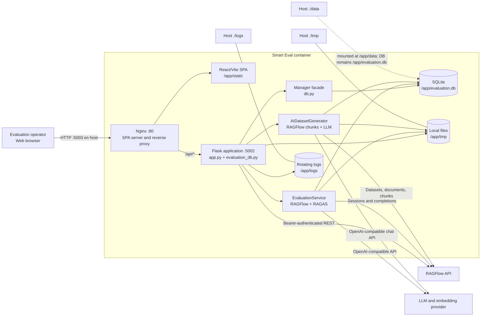
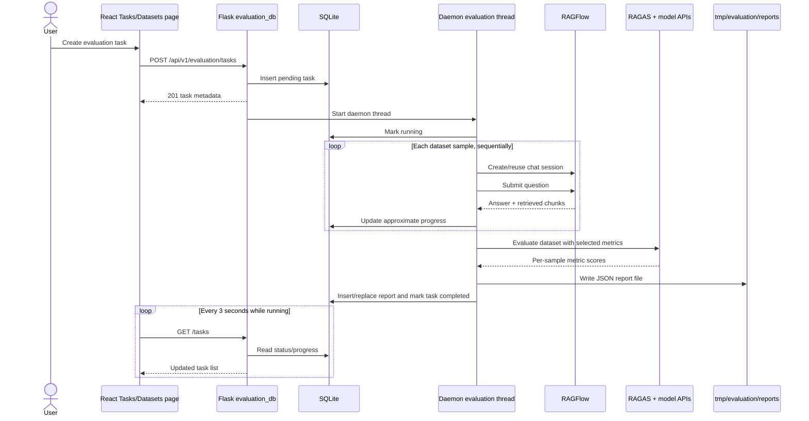

# Architecture Overview

Smart Eval is a browser-based evaluation system for retrieval-augmented generation (RAG) assistants. It lets an operator configure an OpenAI-compatible model provider, import or generate question/answer datasets, run RAGAS metrics against a RAGFlow chat assistant, monitor task progress, and inspect reports. The repository contains both application source and deployment automation.

The implemented architecture is a **single-container modular monolith**:

- a React single-page application (SPA) is compiled to static assets;
- Nginx serves the SPA and proxies API traffic;
- a Flask process exposes the application API;
- SQLite stores configuration, dataset metadata, tasks, and report metadata/results;
- local files store dataset payloads, generated reports, and logs;
- in-process daemon threads perform dataset parsing, dataset generation, and evaluations;
- RAGFlow and OpenAI-compatible model endpoints are external runtime dependencies.

The primary users appear to be administrators or evaluation operators. A separate end-user identity model is **not evident from the repository**.

## 1. Project Structure

```text
smartq_eval/
├── backend/
│   ├── app.py                         # Flask application factory and root/proxy routes
│   ├── evaluation_db.py               # Active /api/v1/evaluation blueprint and workflows
│   ├── api_optimized.py               # Alternative blueprint; not registered by app.py
│   ├── config.py                      # Environment-backed Flask and model configuration
│   ├── db.py                          # Active manager facade over DatabaseManager
│   ├── models/
│   │   ├── database.py                # SQLite schema, singleton, and persistence primitives
│   │   └── __init__.py
│   ├── services/
│   │   ├── evaluation_service.py      # RAGFlow querying and RAGAS execution
│   │   ├── ai_dataset_generator.py    # RAGFlow chunk retrieval and LLM Q/A generation
│   │   ├── metrics_manager.py         # Metric metadata registry
│   │   ├── dataset_manager.py         # Alternative async file dataset manager
│   │   ├── unified.py                 # Alternative service facade used by api_optimized.py
│   │   └── __init__.py
│   ├── utils/shared_utils.py          # Response/validation helpers for alternative API layer
│   ├── init_db.py                     # Manual database initialization utility
│   ├── init_statistics.py             # Separate schema migration utility; not in startup path
│   ├── test_db.py                     # Interactive database/API smoke script
│   └── requirements.txt               # Python runtime dependencies
├── frontend/
│   ├── index.html                     # Vite HTML entry
│   ├── package.json                   # React dependencies and Vite/type-check commands
│   ├── vite.config.ts                 # Dev server, /api proxy, and production output
│   ├── tsconfig*.json                 # TypeScript configuration
│   └── src/
│       ├── main.tsx                   # React DOM entry
│       ├── App.tsx                    # Application shell and client-side routes
│       ├── pages/                     # Dashboard, Datasets, Tasks, Reports, Settings
│       ├── services/api.ts            # Axios client, headers, and error presentation
│       ├── services/evaluation.ts     # Backend and RAGFlow proxy API contracts
│       ├── hooks/useBatchDelete.tsx   # Shared batch-delete interaction state
│       ├── components/BatchActionBar.tsx
│       ├── App.css / index.css
│       └── adapters/, core/, helpers/,
│           cancel/, defaults/, platform/, axios.js
│                                         # Vendored Axios-like JS source; not imported by SPA TS
├── .github/workflows/
│   ├── backend-ci.yml                 # Python dependency, flake8, and advisory pytest job
│   ├── frontend-ci.yml                # npm install, type-check, and production build
│   └── docker-build.yml               # Buildx image build, smoke test, and release/main push
├── Dockerfile                         # Node build stage + Python/Nginx/Supervisor runtime
├── docker-compose.yml                 # Single service, mounts, network, health check
├── .env.example                       # Runtime and integration configuration template
├── start.sh / stop.sh / update.sh     # Operator lifecycle scripts
├── backup.sh                          # Archive data/tmp/logs/.env and retain recent backups
├── check-before-publish.sh            # Informational release checks; always exits successfully
├── images/                            # Documentation screenshots
├── README.md / QUICKSTART.md          # User and deployment documentation
├── CONTRIBUTING.md / RELEASE_CHECKLIST.md
├── AGENTS.md                          # Repository-specific contributor instructions
├── .editorconfig                      # Shared whitespace/encoding defaults
└── .vscode/, .agents/, .specify/,
    docs/openspec/                      # Editor/agent/spec tooling; not part of runtime
```

Generated or runtime-only paths are excluded from Git:

- `frontend/node_modules/` and `frontend/dist/`;
- `.env`;
- `data/`, `logs/`, `tmp/`, and `backups/`.

### Change-impact map

| Change goal                    | Primary locations                                                      | Likely impact                                 |
| ------------------------------ | ---------------------------------------------------------------------- | --------------------------------------------- |
| Add or change a page           | `frontend/src/pages/`, `frontend/src/App.tsx`                          | Routing, API calls, Ant Design UI             |
| Change frontend API contracts  | `frontend/src/services/api.ts`, `frontend/src/services/evaluation.ts`  | All pages consuming that contract             |
| Add an active API endpoint     | `backend/evaluation_db.py`                                             | Flask API and frontend contract               |
| Change evaluation behavior     | `backend/services/evaluation_service.py`                               | RAGFlow calls, RAGAS input/output, reports    |
| Change dataset generation      | `backend/services/ai_dataset_generator.py`, `backend/evaluation_db.py` | RAGFlow chunk reads, LLM calls, dataset files |
| Change persistence/schema      | `backend/models/database.py`, `backend/db.py`                          | SQLite compatibility and all CRUD flows       |
| Change model/provider settings | `backend/config.py`, configuration routes, Settings page               | LLM, embeddings, connection tests             |
| Change packaging/runtime       | `Dockerfile`, `docker-compose.yml`, shell scripts                      | Build, mounts, ports, process lifecycle       |

## 2. High-Level System Diagram



The host exposes only Nginx on port `5003`. Flask remains internal to the container on port `5002`.

## 3. Core Components

### 3.1 Frontend / User Interface

**Runtime role:** browser SPA for operating evaluations.

**Framework and rendering model**

- React 18 renders client-side through `createRoot`.
- `BrowserRouter` handles five routes:
    - `/` — dashboard and aggregate statistics;
    - `/datasets` — dataset upload, preview, deletion, AI generation, and task creation;
    - `/tasks` — task creation and lifecycle controls;
    - `/reports` — report list/detail and filtering;
    - `/settings` — model provider and system configuration.
- Unknown routes redirect to `/`.

**Component and state organization**

- Ant Design supplies layouts, forms, tables, dialogs, notifications, icons, and theme tokens.
- State is local React state plus reusable hooks. Redux, Zustand, MobX, or another global state store is **not evident from the repository**.
- `useBatchDelete` and `BatchActionBar` are the main shared interaction abstractions.
- Pages poll every three seconds while datasets or tasks are still active. Reports contain similar polling logic, although persisted reports normally represent completed tasks.

**API access**

- `frontend/src/services/api.ts` creates an Axios client with base URL `VITE_API_BASE_URL` or `/api/v1`.
- Production calls therefore become `/api/v1/evaluation/...` and are proxied by Nginx.
- The client reads `auth_token` and `user_id` from `localStorage`, adding `Authorization` and `X-User-Id` headers when present.
- Axios response bodies are unwrapped globally. HTTP failures are presented through Ant Design messages.
- A second Axios client targets `/api/v1/evaluation/ragflow/api/v1`, allowing the browser to access selected RAGFlow endpoints through Flask.

**Build and deployment**

- `npm run build` performs TypeScript checking and a Vite production build.
- The output is `frontend/dist/`, copied to `/app/static` in the runtime image.
- Nginx uses SPA fallback routing with `try_files ... /index.html`.

The `frontend/src/adapters`, `core`, `helpers`, `cancel`, `defaults`, `platform`, and root Axios-like JavaScript files reproduce internal Axios source modules. The application imports the installed `axios` package instead, and TypeScript excludes `.js` through `allowJs: false`; these files are not part of the observed SPA dependency path.

### 3.2 Backend / Server / API

**Runtime:** Python 3.12, Flask 3, Flask-CORS.

`backend/app.py` is the application factory. It:

1. loads a `Config` subclass;
2. attempts to load project, backend, and adjacent Smart `.env` files;
3. configures console and rotating-file logging;
4. initializes manager/service singletons;
5. registers the `evaluation_db` blueprint at `/api/v1/evaluation`;
6. adds root health, root metadata, and a separate `/api/ragflow/<path>` proxy;
7. runs Flask's built-in server when executed as a script.

`backend/evaluation_db.py` is the active controller/workflow module. Its 34 blueprint routes cover:

| Area                    | Active routes                                                                                                                                                             |
| ----------------------- | ------------------------------------------------------------------------------------------------------------------------------------------------------------------------- |
| Configuration           | `GET/PUT /config`; `GET/POST /api-configs`; `PUT/DELETE /api-configs/<id>`                                                                                                |
| Datasets                | `GET/POST /datasets`; `GET/DELETE /datasets/<id>`; `GET /datasets/<id>/samples`; `DELETE /datasets/batch`; `POST /datasets/generate/<type>`; `POST /datasets/generate/ai` |
| Tasks                   | `GET/POST /tasks`; `GET/DELETE /tasks/<id>`; `DELETE /tasks/batch`; `POST /tasks/<id>/{start,pause,cancel,retry}`                                                         |
| Reports                 | `GET /reports`; `GET/DELETE /reports/<task_id>`; `DELETE /reports/batch`                                                                                                  |
| RAGFlow discovery/proxy | `GET /knowledgebases`; `GET /knowledgebases/<id>`; all common methods on `/ragflow/<path>`                                                                                |
| Operations              | `GET /metrics`; `GET /statistics`; `GET /health`; `POST /test-connection`                                                                                                 |

Inputs are JSON, query parameters, or multipart uploads. Outputs are primarily JSON with standard HTTP status codes, but response shapes are not normalized across every route.

`backend/api_optimized.py` defines another blueprint with overlapping routes and additional contracts such as `/metrics/groups`, `/quick`, and report export. It depends on `services/unified.py` and `utils/shared_utils.py`. `app.py` does not import or register it, so it is not part of the observed runtime.

### 3.3 Persistence and Manager Layer

`backend/models/database.py` owns the SQLite connection, schema creation, default configuration insertion, indexes, and primitive CRUD. It exposes a process-wide `get_db_manager()` singleton.

`backend/db.py` is the active facade used by `evaluation_db.py`. It creates four process-wide managers:

- `ConfigManager` — API configurations and system settings;
- `DatasetManager` — dataset metadata plus reads from `tmp/datasets/<id>.json`;
- `TaskManager` — task persistence, pagination, state, and aggregate statistics;
- `ReportManager` — report persistence, list/detail reads, deletion, and score aggregates.

Business workflows call these facades directly. There is no ORM, repository interface, transaction unit-of-work, or dependency-injection container.

### 3.4 Evaluation Services

#### `EvaluationService`

This service owns the principal evaluation pipeline:

- lazily constructs `ChatOpenAI` and `OpenAIEmbeddings` clients;
- wraps them for RAGAS;
- supports `faithfulness`, `answer_correctness`, `context_precision`, `context_recall`, and `answer_relevancy`;
- creates/reuses a RAGFlow chat session;
- submits each dataset question to RAGFlow sequentially;
- converts answers, retrieved chunks, and references to `SingleTurnSample` objects;
- calls synchronous RAGAS evaluation through an executor;
- aggregates mean, standard deviation, minimum, maximum, valid count, and per-sample scores.

Per-question RAGFlow failures are converted to empty answers and contexts, allowing the remaining evaluation to continue.

#### `AIDatasetGenerator`

This service:

- reads RAGFlow datasets, documents, and chunks;
- selects chunks and question types;
- calls the default configured chat model through `ChatOpenAI`;
- validates JSON Q/A responses and retries generation;
- returns samples containing question, expected answer, source context, document metadata, and generation metadata.

If RAGFlow chunk retrieval fails or produces no data, the service currently falls back to two built-in mock chunks. That behavior can create a dataset unrelated to the requested knowledge base.

#### `MetricsManager`

This class stores metadata about available metrics and can validate whether a dataset supplies required references/contexts. The active `/metrics` endpoint currently returns a separate hard-coded metric list rather than serializing this registry.

### 3.5 Background Work

The system has no external job queue. Dataset parsing, AI dataset generation, initial task execution, start, and retry create daemon `threading.Thread` instances inside the Flask process.

Consequences:

- jobs are not durable across process/container restarts;
- there is no distributed ownership or lease for a task;
- pause/cancel only change database status and do not signal the running thread;
- a thread can later mark a paused/cancelled task completed;
- horizontal replicas could execute or mutate tasks without coordination.

### 3.6 Shared and Alternative Code

- `services/unified.py` and `api_optimized.py` form an alternative service/controller design, but their APIs do not match all active persistence methods and they are not registered.
- `services/dataset_manager.py` is an async, directory-oriented dataset store. The active runtime instead uses the synchronous `db.py::DatasetManager`.
- `utils/shared_utils.py` provides response formatting, validation, error logging, batch operation, provider validation, and file-extension helpers for the alternative API path.

These parallel abstractions are architectural debt rather than independently deployed components.

### 3.7 CLI / Scripts / Automation

- `start.sh` checks Docker/Compose, loads `.env`, validates an LLM key and `IMAGE_NAME`, pulls a missing image, starts Compose, and polls `/health`.
- `stop.sh` runs `docker compose down`.
- `update.sh` archives `data/` and `tmp/`, stops the service, pulls the configured image, restarts, and health-checks it.
- `backup.sh` archives `data/`, `tmp/`, `logs/`, and `.env`, retaining recent archives.
- `check-before-publish.sh` reports required-file, permission, secret-pattern, configuration, and Git checks. All outcomes are informational and it exits `0`.
- `init_db.py`, `init_statistics.py`, and `test_db.py` are manual Python utilities rather than startup migrations or automated test commands.

## 4. Data Flow

### 4.1 Normal HTTP request lifecycle

1. The browser requests the SPA from host port `5003`.
2. Nginx serves static assets or sends SPA routes to `index.html`.
3. Requests under `/api/` are proxied to Flask at `127.0.0.1:5002`.
4. Flask routes validate basic fields and call manager/service singletons.
5. Managers read/write SQLite and local files; integration services call RAGFlow or model APIs.
6. Flask returns JSON; Axios unwraps the body and pages update local React state.

### 4.2 Dataset upload

1. The frontend uploads multipart form data to `POST /api/v1/evaluation/datasets`.
2. Flask accepts `.json`, `.jsonl`, `.csv`, `.xlsx`, and `.xls`.
3. The original bytes are written to `tmp/datasets/<dataset_id><original_extension>`.
4. A dataset row is inserted with `status=processing`.
5. A daemon thread parses the in-memory upload and computes sample count/reference/context flags.
6. The thread updates status to `completed` or `failed`.
7. The frontend polls the dataset list every three seconds while any dataset is pending/processing.

The active sample reader later opens `tmp/datasets/<dataset_id>.json` regardless of the stored `storage_path`. The upload thread does not write a normalized JSON file. Therefore JSON uploads work only when their original extension is `.json`; JSONL, CSV, and Excel metadata can complete while subsequent preview/evaluation reads fail.

### 4.3 AI dataset generation

1. The frontend posts a RAGFlow knowledge-base ID, sample count, and question types.
2. Flask inserts a processing dataset row and starts a daemon thread.
3. `AIDatasetGenerator` fetches documents and chunks from RAGFlow.
4. It calls the configured LLM for each selected chunk and validates the JSON response.
5. Successful samples are written to `tmp/datasets/<dataset_id>.json`.
6. Dataset metadata is updated to completed/failed and the frontend polling loop observes the change.

### 4.4 Evaluation task lifecycle



`batch_size` is stored and logged but the current evaluation implementation prepares samples sequentially and passes the entire `EvaluationDataset` to RAGAS. RAGAS uses a hard-coded `RunConfig(max_workers=2, max_retries=2, timeout=300)`.

### 4.5 Report and dashboard reads

- Reports are reconstructed from JSON text columns in SQLite and enriched with task/dataset names.
- A separate JSON report file is also generated under `tmp/evaluation/reports/`.
- Dashboard statistics aggregate task statuses, dataset counts, recent report scores, and average completion time.
- The statistics response currently maps several count fields incorrectly: `total_tasks`, `running_tasks`, and `completed_tasks` are populated from running, completed, and failed counts respectively.

## 5. Data Stores

### 5.1 SQLite

**Observed runtime path:** `/app/evaluation.db` in the container, because `DatabaseManager()` derives the path from `backend/models/database.py` and does not consume `DATABASE_PATH`.

**Connection model:** a new `sqlite3` connection per operation with `check_same_thread=False` and row dictionaries through `sqlite3.Row`.

| Table                | Purpose                                 | Important fields                                                                                       |
| -------------------- | --------------------------------------- | ------------------------------------------------------------------------------------------------------ |
| `api_configs`        | Model/provider credentials and defaults | provider, plaintext `api_key`, endpoint, model, embedding model, temperature, max tokens, default flag |
| `system_settings`    | Categorized string settings             | key, value, description, category                                                                      |
| `datasets`           | Dataset metadata and processing state   | ID, original file metadata, storage path, counts, capability flags, status/progress/error              |
| `evaluation_tasks`   | Evaluation lifecycle                    | chat ID, dataset ID, selected metrics JSON, model names, status/progress/counts/timestamps             |
| `evaluation_reports` | One report per task                     | overall/detailed/metadata JSON, generated report path                                                  |
| `evaluation_logs`    | Intended task log records               | level, message, details; no write/read path is currently evident                                       |

Indexes exist for dataset name, task status, task creation time, report task ID, and setting category.

Schema initialization is automatic through `CREATE TABLE IF NOT EXISTS` when the database singleton is first created. A formal ordered migration framework is **not evident from the repository**. `init_statistics.py` defines a separate, incompatible `evaluation_reports` shape and is not called by application startup.

### 5.2 Dataset files

- Active workflows expect normalized samples at `/app/tmp/datasets/<dataset_id>.json`.
- AI-generated and built-in sample datasets use this shape.
- Uploaded source files retain their original extension.
- Dataset metadata is stored in SQLite; sample records are not normalized into database rows.

### 5.3 Report files

Each completed evaluation writes a JSON report under `/app/tmp/evaluation/reports/`. SQLite stores the same score structures and the file path. There is no retention or cleanup policy for report files in application code.

### 5.4 Logs

Flask logs go to stdout and `/app/logs/evaluation.log`. The rotating handler uses approximately 10 MB per file and ten backups. Docker also uses the `json-file` driver with `10m` and three files.

### 5.5 Mount and backup boundary

Compose mounts:

- host `./data` to `/app/data`;
- host `./logs` to `/app/logs`;
- host `./tmp` to `/app/tmp`.

Because SQLite is actually `/app/evaluation.db`, it is outside the mounted `data` directory. Container recreation can therefore discard the database, and host backup scripts that archive `data/` do not capture the observed database file. This conflicts with `.env.example` and README claims that the database is `data/evaluation.db`.

No Redis, object store, external SQL database, cache, or message queue is evident.

## 6. External Integrations / APIs

### 6.1 RAGFlow

**Authentication:** `Authorization: Bearer <RAGFLOW_API_KEY>`.

**Uses:**

- knowledge-base discovery through RAGFlow datasets;
- dataset document and chunk retrieval for Q/A generation;
- chat assistant discovery through the generic proxy;
- chat session creation and completion requests during evaluation;
- generic proxied GET/POST/PUT/DELETE/PATCH requests.

**Observed paths constructed by code:**

- `/api/v1/datasets` and `/api/v1/datasets/<id>`;
- `/api/v1/datasets/<id>/documents`;
- `/api/v1/datasets/<id>/documents/<id>/chunks`;
- `/api/v1/chats/<chat_id>/sessions`;
- `/api/v1/chats/<chat_id>/completions`.

Timeouts range from 10 seconds for knowledge-base discovery, to 30 seconds for document/chunk calls, to 60 seconds for chat completions. Retries for RAGFlow HTTP requests are not implemented at the transport layer.

The base URL contract is inconsistent: several modules append `/api/v1`, while `.env.example` includes `/api/v1` in its sample `RAGFLOW_BASE_URL`. Using that sample literally can produce duplicated `/api/v1/api/v1` paths.

### 6.2 OpenAI-compatible model providers

`langchain-openai` is used for chat and embedding calls. The code provides defaults for:

- OpenAI;
- SiliconFlow;
- DeepSeek;
- Zhipu.

The Settings page additionally offers Moonshot endpoint defaults, but backend provider validation/default maps do not consistently include Moonshot.

The model provider supplies two roles:

- answering RAGAS judge prompts and embedding texts during evaluation;
- generating reference Q/A samples from RAGFlow chunks.

No provider-specific SDK besides the OpenAI-compatible LangChain client is used.

### 6.3 Other integrations

Payment, email, identity provider, telemetry SaaS, cloud storage, and managed database integrations are **not evident from the repository**.

## 7. Key Technologies

| Technology             | Architectural role                                           |
| ---------------------- | ------------------------------------------------------------ |
| Python 3.12            | Backend runtime and container base                           |
| Flask / Flask-CORS     | HTTP API, application factory, CORS                          |
| SQLite                 | Embedded metadata/result store                               |
| RAGAS                  | LLM-based RAG evaluation engine                              |
| LangChain OpenAI       | Provider-compatible chat and embedding adapters              |
| `requests` / `aiohttp` | Synchronous discovery/generation and asynchronous chat calls |
| pandas / NumPy         | Dataset parsing and score aggregation                        |
| React 18 / TypeScript  | Browser SPA                                                  |
| React Router           | Client-side page routing                                     |
| Ant Design             | UI component system and notifications                        |
| Axios                  | Browser HTTP clients and interceptors                        |
| Vite                   | Development server and production bundler                    |
| Nginx                  | Static serving and reverse proxy                             |
| Supervisor             | Runs Nginx and Flask in one container                        |
| Docker / Compose       | Packaging and single-service deployment                      |
| GitHub Actions         | Backend, frontend, and container build workflows             |
| Bash                   | Lifecycle, backup, update, and release checks                |

`gunicorn` is installed and documented for source deployment, but the container starts `python3 app.pyc`, which uses Flask's built-in server. A production WSGI server is not used in the observed image runtime.

The repository has `.editorconfig`, but Black and Prettier are not pinned as project dependencies or configured through checked-in formatter files.

## 8. Deployment & Infrastructure

### 8.1 Image build

The Dockerfile uses two stages:

1. `node:20-alpine` installs frontend dependencies from a configurable npm registry and runs the Vite build.
2. `python:3.12-slim` installs Nginx, Supervisor, Python dependencies, backend code, and compiled frontend assets.

Build arguments default to domestic mirrors for npm, Debian packages, and PyPI. They can be overridden at build time.

Python files are compiled beside the source to `.pyc`; non-`__init__.py` sources are then removed. This reduces distributed source visibility but is not a security boundary.

### 8.2 Runtime process topology

Supervisor runs two processes as root:

- Nginx on port 80;
- Flask's built-in server on port 5002.

Nginx proxies `/api/` and `/health`, with API read timeout set to 300 seconds. The image exposes port 80 and performs a curl health check against `/health`.

### 8.3 Compose deployment

Compose defines one service and one bridge network. The image name is supplied by `.env` through `IMAGE_NAME`, defaulting to `smart-eval:latest`. Host port `5003` maps to container port `80`. Restart policy is `unless-stopped`.

`start.sh` is optimized for image-based deployment: if the configured image exists locally it skips pulling; otherwise it runs `docker compose pull`.

### 8.4 CI/CD and hosting

Three GitHub Actions workflows are present:

- `backend-ci.yml` installs Python 3.12 dependencies, runs a blocking flake8 syntax/error selection, then a non-blocking broader flake8 report. Its pytest command is also non-blocking through `|| echo`, and `pytest` is not installed by `backend/requirements.txt`.
- `frontend-ci.yml` uses Node 20, runs `npm ci`, TypeScript checking, and the production build.
- `docker-build.yml` uses Buildx and GitHub Actions cache, builds and loads an image, attempts a container health smoke test, and pushes on releases or main-branch pushes.

The Docker smoke command addresses `${IMAGE_NAME}:${github.sha}`, while Docker metadata normally emits branch/PR/semver and `sha-<short>` tags. The exact full-SHA tag used by the smoke command is not visibly produced, so the workflow requires correction or live confirmation.

A cloud provider, Kubernetes deployment, Terraform, or Helm configuration is **not evident from the repository**. The runtime deployment target remains any Docker-capable host; the destination registry/account for image pushes is not specified beyond the unqualified `smart-eval` image name.

## 9. Security Architecture

### Implemented controls

- `.env` is Git-ignored and excluded from the Docker build context.
- API keys returned in API configuration lists are masked.
- Upload extensions are restricted and Flask has a configurable maximum content length.
- CORS origins are configurable.
- The RAGFlow API key is added server-side for proxy and integration calls.
- Database SQL values are generally parameterized; dynamic SQL is used for known field lists and placeholder counts.

### Trust boundaries and gaps

- Backend authentication and authorization are **not evident from the repository**. No route verifies the frontend `Authorization` token.
- `X-User-Id` is accepted as caller-supplied metadata and is not authenticated.
- The frontend adds `X-User-Id`, while the global CORS allow-header list includes only `Content-Type` and `Authorization`; route-level `cross_origin()` usage makes the effective behavior inconsistent.
- API keys are stored in plaintext in SQLite. Encryption at rest is **not evident**.
- Nginx listens on HTTP only. TLS termination is **not evident from the repository**.
- The generic RAGFlow proxy expands access to upstream paths without a local authorization layer.
- The default Flask `SECRET_KEY` is a hard-coded fallback.
- No CSRF protection, rate limiting, CSP, WAF, request signing, audit log, or dependency-vulnerability gate is evident.
- Supervisor and both application processes run as root inside the container.

The system should therefore be treated as an internal administrative tool unless an authenticated gateway and network controls are supplied externally.

## 10. Monitoring & Observability

**Available:**

- console and rotating-file Python logs;
- Docker JSON logs with rotation;
- root `/health` endpoint for basic process readiness;
- blueprint `/api/v1/evaluation/health` for database, evaluation-service, and metric-manager availability;
- `/statistics` for domain-level counts and recent scores;
- detailed evaluation progress and exception logs;
- frontend console logging and user-facing error messages.

**Not evident:**

- Prometheus/OpenTelemetry metrics;
- distributed tracing;
- centralized log shipping;
- external error reporting;
- alert definitions or operational dashboards;
- durable audit logging.

The `evaluation_logs` table is defined but unused, and `NaNSafeJSONEncoder` is defined but not installed on the Flask app.

## 11. Performance & Scalability

- Dataset/task/report lists use SQL `LIMIT`/`OFFSET`; pages frequently request up to 100 rows.
- Dataset and task activity is observed by three-second frontend polling, increasing read load linearly with browser sessions.
- RAGFlow questions are processed sequentially per task. This is predictable but can make large datasets slow.
- RAGAS uses two workers, two retries, and a 300-second timeout, hard-coded in `EvaluationService` rather than read from configuration.
- Evaluation threads share one Flask process and an embedded SQLite file. There is no workload isolation or backpressure.
- SQLite connections allow cross-thread use, but no explicit busy timeout, WAL mode, or application lock is configured.
- AI generation limits a request to 1–100 samples and reads at most ten documents per generation pass.
- No application cache is evident.
- The current frontend production build succeeds but produces an approximately 1.42 MB minified JavaScript chunk (about 448 KB gzip), and Vite warns that it exceeds the 500 KB chunk threshold.
- Nginx allows up to 300 seconds for proxied API responses, while the browser Axios timeout is 30 seconds; long synchronous endpoints can time out in the browser first.

The current topology is suitable for a small single-host workload. Multi-instance scaling would require externalized persistence, durable jobs, coordinated task ownership, and removal of process-local singletons.

## 12. Development Workflow

### Source development

Backend:

```bash
python3 -m venv .venv
source .venv/bin/activate
pip install -r backend/requirements.txt
cd backend
python app.py
```

Backend imports are top-level (`from config`, `from db`), so running from `backend/` or setting `PYTHONPATH=backend` is required.

Frontend:

```bash
cd frontend
npm ci
npm run dev       # Vite on port 5173, proxies /api to localhost:5002
npm run typecheck
npm run build
```

Container workflow:

```bash
cp .env.example .env
# Set IMAGE_NAME, RAGFlow credentials, and at least one model provider key.
docker build -t smart-eval:latest .
docker compose up -d
curl -f http://localhost:5003/health
```

Operator scripts provide `./start.sh`, `./stop.sh`, `./update.sh`, and `./backup.sh` shortcuts.

### Configuration loading

Compose passes `.env` into the process before Python starts, which is the reliable container path. In source mode, `app.py` imports and applies `Config` before it calls `load_dotenv`; class-level environment-derived values may therefore miss values that exist only in the file. Later `ConfigService` lookups call `os.getenv` dynamically, creating two timing models for configuration.

Important naming drift exists between `.env.example` and code:

- template `DEFAULT_MODEL` vs code `DEFAULT_LLM_MODEL`;
- template `MAX_WORKERS` / `MAX_RETRIES` vs code `EVALUATION_MAX_WORKERS` / `EVALUATION_MAX_RETRIES`;
- template `DATASETS_DIR` / `REPORTS_DIR` are not used by `Config`, which derives both from `TEMP_DIR`;
- template `DATABASE_PATH=data/evaluation.db` is not used by `DatabaseManager`.

### Code quality commands

The repository directly provides TypeScript build/type-check scripts and shell syntax can be checked with Bash. Python compilation is available through the standard library:

```bash
python3 -m compileall -q backend
bash -n start.sh stop.sh update.sh backup.sh check-before-publish.sh
cd frontend && npm run typecheck && npm run build
```

Black and Prettier can be used externally, but their versions/rules are not pinned in project configuration.

## 13. Testing Strategy

GitHub Actions provides build/lint automation, but a conventional isolated automated test suite is not currently present.

- `backend/test_db.py` is an interactive smoke script. It initializes the singleton database, inserts test settings/datasets/tasks/reports, and optionally calls a running API. Its functions are named like tests but depend on interactive/process state and are not isolated.
- `backend-ci.yml` attempts `python -m pytest test_db.py -v`, but does not install pytest and suppresses failure with `|| echo`; therefore it is not a reliable test gate in its current form.
- `frontend-ci.yml` reliably type-checks and builds, but frontend unit, component, and end-to-end test frameworks/configurations are not evident.
- `docker-build.yml` declares a runtime health smoke test, but its image tag reference appears inconsistent with the metadata-generated tags.
- Test fixtures, mocks, coverage thresholds, and behavioral quality gates are not evident.
- `check-before-publish.sh` checks repository packaging concerns but intentionally reports findings without failing the process.

### Validation performed during the 2026-08-22 architecture review

- Python `compileall`: passed.
- Frontend TypeScript and Vite production build: passed.
- Shell syntax checks: passed.
- Full Docker image build: passed.
- Container smoke checks passed for `/`, `/health`, `/api/v1/evaluation/health`, `/metrics`, and `/statistics`.
- Runtime inspection confirmed `/app/evaluation.db`, compiled `/app/app.pyc`, static SPA assets, and removal of `/app/app.py`.
- Black 26.5.1 check did not pass: five backend files would be reformatted. This is a formatting gap, not a Python compilation failure.

## 14. Architectural Decisions & Rationale

### Single all-in-one container

- **Decision:** package frontend, reverse proxy, API, evaluation engine, and SQLite together.
- **Evidence:** Dockerfile, Supervisor config, and Compose single service.
- **Rationale:** documentation emphasizes simple deployment without requiring host Python or Node installations.
- **Consequences:** simple installation and one health target, but coupled scaling, upgrades, security context, and failure domains.

### Embedded SQLite with JSON columns

- **Decision:** store structured metadata relationally while encoding metric lists and result payloads as JSON text.
- **Evidence:** `DatabaseManager` schema and serializers.
- **Rationale:** the database module explicitly describes SQLite as lightweight; deeper rationale is not documented.
- **Consequences:** low operational overhead, but limited concurrent write scaling, weak queryability of score payloads, and schema evolution risk.

### In-process asynchronous work

- **Decision:** use daemon threads for long-running operations.
- **Evidence:** dataset upload/generation and task start/retry routes.
- **Rationale:** not documented; likely minimizes infrastructure.
- **Consequences:** no durable queue, cancellation, ownership, retries after restart, or horizontal coordination.

### Browser polling instead of server push

- **Decision:** poll active dataset/task/report lists every three seconds.
- **Evidence:** page effects in Datasets, Tasks, and Reports.
- **Rationale:** not documented.
- **Consequences:** simple HTTP model but repeated reads and delayed updates.

### OpenAI-compatible provider abstraction

- **Decision:** route several providers through `ChatOpenAI` and `OpenAIEmbeddings`.
- **Evidence:** provider endpoint maps and Settings UI.
- **Rationale:** not documented.
- **Consequences:** shared integration path, but provider feature differences and endpoint compatibility are assumed.

### Bytecode-only runtime packaging

- **Decision:** compile backend to `.pyc` and remove most `.py` files.
- **Evidence:** Dockerfile.
- **Rationale:** comments and release documentation describe source non-disclosure/image minimization.
- **Consequences:** harder production debugging and no meaningful protection against reverse engineering.

## 15. Constraints, Risks, and Technical Debt

1. **Two overlapping backend architectures.** `evaluation_db.py` + `db.py` are active; `api_optimized.py` + `services/unified.py` are inactive. Their route sets and persistence contracts differ, increasing drift and making the intended migration unclear.
2. **SQLite is outside the persistent mount.** The observed database is `/app/evaluation.db`, while Compose mounts `/app/data`. Container replacement and backups can lose relational state.
3. **Uploaded non-JSON datasets are not normalized.** Metadata parsing supports JSONL/CSV/Excel, but active reads require `<id>.json`.
4. **RAGFlow base URL contract is ambiguous.** Code appends `/api/v1`; the example URL already includes it.
5. **Frontend exposes inactive contracts.** `evaluation.ts` defines metric groups/validation, quick evaluation, report export, and report comparison endpoints that exist only in the unregistered alternative blueprint or nowhere. They are currently unused by pages but create misleading API surface.
6. **Task pause/cancel are state-only.** Running threads are not interrupted or consulted.
7. **No backend authentication/authorization.** Browser-supplied tokens and user IDs are not verified.
8. **Configuration names and load timing drift.** Several `.env.example` variables are ignored, and source-mode dotenv loading occurs after class-level configuration evaluation.
9. **Schema utilities conflict.** `init_statistics.py` declares a different report primary key and columns from `DatabaseManager`; `init_db.py` inspects a working-directory database that may differ from the singleton path.
10. **Metric metadata is duplicated.** Active endpoint metadata, `MetricsManager`, and RAGAS objects can disagree; the registry's `context_recall` entry currently identifies itself as `answer_relevancy`.
11. **Statistics field mapping is incorrect.** Several dashboard counters are populated from the wrong task statistics.
12. **Mock fallback can contaminate generated datasets.** RAGFlow retrieval failure silently switches to unrelated built-in AI/ML passages.
13. **No durable job recovery.** A restart leaves tasks in stale states and loses in-flight work.
14. **Observability tables/utilities are unused.** `evaluation_logs` and `NaNSafeJSONEncoder` have no active integration.
15. **Frontend contains unused vendored Axios internals.** They increase repository size and cognitive load without participating in the app build path.
16. **Production image uses Flask's development server.** `gunicorn` is installed but not used by Supervisor.
17. **Source provenance risk.** `evaluation_service.py` is marked as decompiled from Python 3.10 bytecode, so semantic fidelity and maintainability require extra review.
18. **Documentation drift.** The changelog says MIT while the repository contains AGPL-3.0; contributor docs still describe a deployment-only repository; some commands use obsolete `docker-compose`; README mentions an API documentation route that is not registered.
19. **Formatting is not enforced.** No pinned formatter or formatter CI check exists, and the current Black check reports changes.
20. **CI test and smoke gates are weak.** Backend pytest failure is explicitly suppressed, pytest is not installed, and the Docker smoke test appears to reference a tag that the build does not create.
21. **Report/file cleanup is absent.** Deleting metadata does not consistently delete dataset source files or generated reports.

## 16. Future Considerations / Roadmap

### Explicitly documented roadmap

The README lists:

- support for more RAG systems;
- additional evaluation metrics;
- custom evaluation templates;
- team collaboration;
- report comparison;
- performance benchmarking.

### Architectural recommendations

These are recommendations derived from the current structure, not committed roadmap items:

1. Make one blueprint/service stack authoritative and remove or complete the alternative stack.
2. Move SQLite to `/app/data/evaluation.db`, honor `DATABASE_PATH`, and add versioned migrations.
3. Normalize every accepted upload format to a canonical JSON/JSONL artifact before marking it completed.
4. Define one RAGFlow base URL convention and one URL builder shared by all integrations.
5. Replace daemon threads with a durable worker/queue or, at minimum, a recoverable task runner with cancellation tokens.
6. Add authenticated administration, authorization, rate limiting, and explicit proxy policy before exposing the service beyond a trusted network.
7. Run a production WSGI server and a non-root container user.
8. Generate or validate frontend API types from the active Flask route contract.
9. Add isolated unit tests for schema/managers and integration tests for upload, task state, RAGFlow failures, and report generation; add browser tests for the five main pages.
10. Make CI tests blocking, install pytest explicitly, and align the Docker smoke-test tag with metadata output.
11. Split the frontend bundle by route and remove unused vendored Axios source.
12. Align docs, license statements, environment templates, and release scripts with the active implementation.

## 17. Project Identification

| Field                            | Value                                                                                                      |
| -------------------------------- | ---------------------------------------------------------------------------------------------------------- |
| Project name                     | Smart Eval                                                                                                 |
| Repository purpose               | Self-hosted RAG assistant evaluation UI and API                                                            |
| Repository remote                | `git@github.com:pxy0592/smart-evals.git`                                                                   |
| Primary languages                | Python, TypeScript/TSX, JavaScript, CSS, Bash                                                              |
| Application type                 | Browser SPA + HTTP API + background evaluation workflows                                                   |
| Main runtimes                    | Node 20 build stage; Python 3.12 runtime; Nginx; Supervisor; Docker Compose                                |
| Database                         | SQLite                                                                                                     |
| External systems                 | RAGFlow and OpenAI-compatible LLM/embedding providers                                                      |
| License file                     | GNU Affero General Public License v3                                                                       |
| Maintainer/team                  | Docker metadata says “RAG Evaluation Team”; an individual current owner is not evident from the repository |
| Date of last architecture review | 2026-08-22                                                                                                 |

## 18. Glossary / Acronyms

- **AI-generated dataset:** Evaluation questions and expected answers produced from RAGFlow chunks through an LLM.
- **Chat assistant / `chat_id`:** The RAGFlow chat resource queried for each evaluation question.
- **Context:** Retrieved chunk text supplied to RAGAS as grounding evidence.
- **Dataset:** A local collection of questions and optional expected answers/reference contexts, represented by SQLite metadata plus a file under `tmp/datasets/`.
- **Embedding model:** Model used by RAGAS metrics that require semantic similarity.
- **Evaluation task:** Persistent record connecting a chat assistant, local dataset, and selected metrics.
- **LLM:** Large Language Model. Used both as the evaluated/judge model interface and for Q/A generation.
- **RAG:** Retrieval-Augmented Generation; generation grounded in retrieved documents.
- **RAGAS:** The evaluation library used for faithfulness, correctness, precision, recall, and relevancy metrics.
- **RAGFlow:** External RAG platform providing datasets, documents, chunks, chat sessions, retrieved references, and answers.
- **Reference answer:** Expected answer stored in a dataset and required by some metrics.
- **Report:** Aggregated and per-sample evaluation scores stored in SQLite and a JSON file.
- **SPA:** Single-Page Application; the React frontend served by Nginx.
